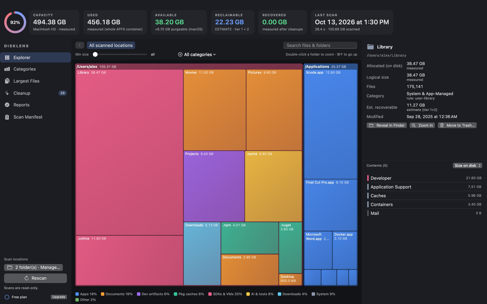
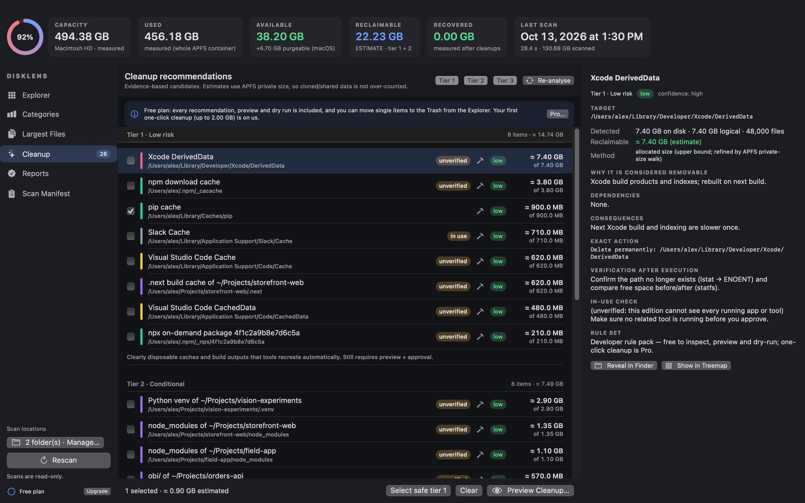

# DiskLens

[](LICENSE)
[](https://github.com/sponsors/MaxRecursion)

A native macOS (SwiftUI) disk-space analyzer and conservative cleaner, built for a developer Mac.
It scans read-only, shows an interactive squarified treemap, attributes every byte to exactly one
category, and produces evidence-backed cleanup recommendations whose reclaimable estimates are
APFS-clone- and hard-link-aware. Nothing is removed without a preview and an explicit approval
bound to the exact plan.




## Download

**[⬇ Download DiskLens for macOS](https://github.com/MaxRecursion/DiskLens/releases/latest)**: a
universal app (Apple silicon + Intel) for macOS 14 or later. The DMG includes `disklens-cli`, which
is also available as a separate zip.

Release builds are not notarized yet (notarization needs a paid Apple Developer membership), so
macOS blocks the first launch. On macOS 15 or later, open the app once, then click **Open Anyway**
in System Settings → Privacy & Security. On macOS 14, right-click the app and choose **Open**. Or
run `xattr -dr com.apple.quarantine /Applications/DiskLens.app`. You can also
[build it from source](#build-test-launch).

## Support DiskLens

DiskLens is free and open source, built and maintained by one developer in their spare time. If it
helped you reclaim space (or just understand where it went), please consider a donation — it pays
for the Apple Developer membership, notarization and the time spent on new rules and fixes.

**[❤ Sponsor DiskLens on GitHub](https://github.com/sponsors/MaxRecursion)** — one-time or monthly,
any amount. Starring the repo, filing issues and sharing it with other Mac developers help too.

**Freemium, one codebase, two editions** (detected at runtime from the App Sandbox):

| | Free (both editions) | Pro |
|---|---|---|
| Scan, treemap, categories, largest files, search, inspector | ✓ | ✓ |
| Scan manifest, coverage gaps ("unknown", never 0), change detection | ✓ | ✓ |
| Full recommendation list with clone-aware estimates, tiers, evidence, exact actions | ✓ | ✓ |
| Preview + dry run of any cleanup, every safety check | ✓ | ✓ |
| Move a single item to the Trash by hand | ✓ | ✓ |
| One-click cleanup of approved plans | 1 free run ≤ 2 GB | ✓ |
| Duplicate finder, developer rule pack (one-click), schedule + menu bar + alerts, export + history | — | ✓ |
| `disklens-cli` execution, policies, export | — | direct edition (Pro/Team key) |

* **Mac App Store edition** — sandboxed (user-granted folders), Pro = StoreKit 2 non-consumable
  `pro.lifetime`, Restore Purchases, Family Sharing on.
* **Direct edition** — Developer ID + notarized, Pro = offline-verified Ed25519 license key, 7-day
  trial, Sparkle 2 updates (Xcode target), `disklens-cli` with Team (yearly, per-machine) keys.

See [docs/LICENSING.md](docs/LICENSING.md) and [docs/RELEASING.md](docs/RELEASING.md).

## Build, test, launch

Only the Xcode **Command Line Tools** are required for builds and tests. App Store archiving and
upload, StoreKit testing and Sparkle need Xcode (`project.yml` → `xcodegen generate`).

```bash
./scripts/test.sh                 # Swift Testing on synthetic fixtures in temp dirs (never your files)
./scripts/build_app.sh            # direct edition (universal) → dist/DiskLens.app + dist/disklens-cli
scripts/package.sh appstore       # sandboxed App Store edition → dist/appstore/DiskLens.app (ad-hoc)
scripts/build-direct.sh           # signed + notarized + stapled DMG when release.config has identities
scripts/build-appstore.sh         # Xcode archive + export for App Store Connect (needs Xcode)
scripts/make_screenshots.sh       # store screenshots at 1280×800, 1440×900, 2560×1600, 2880×1800
open dist/DiskLens.app
```

Release assets: app icon + menu-bar template icon (`Resources/`, `Assets.xcassets`), privacy
manifest, entitlements per edition, Info.plists per edition, String Catalog
(`Resources/Localizable.xcstrings`), StoreKit configuration (`Resources/StoreKit/`), Xcode project
spec (`project.yml`), store listing and review notes (`docs/appstore/`), privacy policy, terms and
support pages (`docs/site/`).

Grant **Full Disk Access** (System Settings → Privacy & Security) to `DiskLens.app` if you want
TCC-protected locations (Trash, Mail, browser profiles, app containers) included; otherwise they are
reported as coverage gaps with *unknown* size.

### CLI (direct edition)

```bash
dist/disklens-cli scan [--json]                       # read-only scan of home + apps + dev locations (free)
dist/disklens-cli recommend [--markdown plan.md] [--json]
dist/disklens-cli plan --select ID,ID                 # or --tier1; add --trash to move to Trash instead
dist/disklens-cli execute --plan FILE --dry-run       # free
dist/disklens-cli execute --plan FILE --approve <plan digest>          # Pro/Team
dist/disklens-cli policy --policy ci.json [--rescan] [--execute] [--json]  # dry run unless --execute
dist/disklens-cli export --markdown report.md --json-file report.json  # Pro/Team
dist/disklens-cli license status | activate --key-file key.txt | deactivate | machine-id
dist/DiskLens.app/Contents/MacOS/DiskLens --snapshot DIR [--demo] [--license free|trial|pro] [--appearance light] [--all-sizes]
```

Policy file: `{"name":"ci-low-space","whenFreeBelowGB":20,"tiers":[1],"rules":["npm-cache","app-cache:"],"action":"delete","maxTotalGB":10}`.
Tier 3 is rejected; only items eligible for automatic selection (not in use, no elevation, fully
analysed) qualify. Exit codes: `0` ok · `1` error · `2` usage · `3` approval refused · `4` license
required · `5` some items failed · `6` policy executed but free space still below its threshold.

Scans, history, recommendations, cleanup reports and the license file are stored in
`~/Library/Application Support/DiskLens/` (the sandboxed edition uses its container). Trial start,
free-run counter and the cached App Store entitlement live in the login Keychain.

## Architecture

```
Sources/DiskLensCore          (library — all logic, fully unit-tested)
  Model/ScanTree.swift        arena tree (parents precede children); ProjectMarkers recorded per folder
  Model/ScanManifest.swift    options, stats, errors, coverage, methodology
  Scan/DiskScanner.swift      fts(3) walker: FTS_PHYSICAL, no mount crossing, hard links once,
                              dataless (cloud-only) folders never entered, privacy-folder probe,
                              cancellation + throttled progress
  Scan/ReclaimEstimator.swift getattrlist(ATTR_CMNEXT_PRIVATESIZE) walk: clone/hard-link aware
  Scan/VolumeInfo.swift       statfs + URLResourceValues (incl. purgeable)
  Scan/ScanStore.swift        persistence, scan history, change detection between scans
  Classify/Classifier.swift   ordered, transparent rules; each node records the rule id
  Treemap/                    squarified layout (Bruls et al.) + tile builder
  Cleanup/PathGuard.swift     canonical, case-folded, scope/protection checks (+ manual-Trash profile)
  Cleanup/RuleCatalog.swift   cleanup rules (tiers, risk, evidence, exact action)
  Cleanup/RecommendationEngine.swift  non-overlapping rule matching + estimate refinement
  Cleanup/DuplicateFinder.swift       SHA-256 duplicate copies (clone-aware), manual review only
  Cleanup/SafeRemoval.swift           O_NOFOLLOW_ANY parent fd + inode check + atomic rename to staging
  Cleanup/CleanupExecutor.swift       dry-run / approved execution, revalidation, verification
  Licensing/FeatureGate.swift         Edition, Feature, LicenseState, RulePack, free-run cap, decisions
  Licensing/LicenseService.swift      StoreKit entitlement + license key + trial → state (injected deps)
  Licensing/PurchaseStore.swift       StoreKit-free purchase protocol, EntitlementPolicy (Family Sharing)
  Licensing/LicenseKey.swift          Ed25519 offline verification, machine identity, license file
  Licensing/SecureStore.swift         Keychain store, trial manager, free-run counter
  Licensing/Paywall.swift             paywall copy from measured numbers only
  Automation/Automation.swift         scan schedule, low-space monitor, CLI cleanup policies, exit codes
  Automation/ReportExporter.swift     Markdown/JSON reports (paths and sizes only)
  Util/Log.swift                      os.Logger categories; paths always privacy: .private
Sources/DiskLensApp           SwiftUI app (dashboard, treemap Canvas, inspector, cleanup, reports,
                              paywall, settings, menu-bar extra, scheduler, StoreKit 2 adapter, Sparkle)
Sources/disklens-cli          headless front end to the same core
scripts/license/              license-key tool (keygen/issue/verify) — never bundled
```

## Privacy

DiskLens collects no data: no analytics, no telemetry, no accounts. Scan results, recommendations
and cleanup reports stay on your Mac in `~/Library/Application Support/DiskLens/` (Settings ▸
Privacy ▸ "Delete Scan Data and Reports…" removes them). The GitHub releases (and any
`scripts/` build) make no network requests of their own; only the Xcode "DiskLens Pro (Direct)"
build checks for updates via Sparkle, which can be turned off. License keys are verified offline,
and Mac App Store purchases are handled entirely by Apple.

## Safety model

* **Scans are read-only.** No file contents are read during scanning; cloud-only (dataless) files
  are never downloaded (`setiopolicy_np` + dataless folders are not entered); privacy-protected
  folders that would block on a consent prompt are skipped and reported.
* **Tiers.** Tier 1 (disposable caches/build output) and tier 2 (conditional: lockfile present,
  pending update, app not running…) can be selected; **tier 3 is never executed** (personal files,
  VM disks, backups, apps, histories, duplicates).
* **Approval.** Execution requires a `CleanupApproval` whose SHA-256 digest matches the exact plan
  (targets, actions, inode identity, tiers). Editing the plan invalidates the approval.
* **Revalidation before every action:** absolute canonical path, no symlink, no `.`/`..`, inside the
  home folder or the user's own temp/cache dirs, not inside or containing a protected location
  (case-folded), owned by the current user, same device+inode as when scanned, owning app not
  running (if the process list cannot be read, such items are skipped). Permanent deletes open the
  validated parent with `O_NOFOLLOW_ANY`, confirm device+inode with `fstatat`, atomically
  `renameatx_np` the item into a DiskLens staging folder and delete it there; on failure it is
  renamed back. Commands run without a shell from an allowlist of absolute executables and are
  killed (TERM, then KILL) on timeout.
* **Verification.** After each action the target must be gone (or the command must succeed);
  free space is measured with `statfs` before and after. Moving to Trash is reversible but frees
  space only after the Trash is emptied — the report says so.

## Measurement notes and limitations

* Allocated size (`st_blocks × 512`) is what a file occupies; APFS clones are double-counted by
  allocated totals (like `du`), so reclaim estimates use private size instead.
* The scan covers the user's home, /Applications, /opt/homebrew, /usr/local, /Library,
  /Users/Shared and the user's /var/folders. Root-only system areas (Spotlight index, unified logs,
  SIP-protected Apple Intelligence assets) and TCC-blocked folders are coverage gaps.
* Files smaller than 1 MB are aggregated per folder (memory bound); search covers folders and
  files ≥ 1 MB.
* With Command Line Tools only, the app builds against the macOS 26.5 SDK because the 27 SDK's
  SwiftUI `@State` macro plugin ships with Xcode only; the app runs natively on macOS 27. The
  treemap is drawn with a SwiftUI `Canvas`, which offscreen `--snapshot` mode renders via
  `ImageRenderer` (`Treemap-*.png`).

## License

[MIT](LICENSE) © 2026 Akshay Kulkarni. The license-signing private key is not part of this
repository; builds you make yourself verify keys against your own key pair
(see [docs/LICENSING.md](docs/LICENSING.md)).
